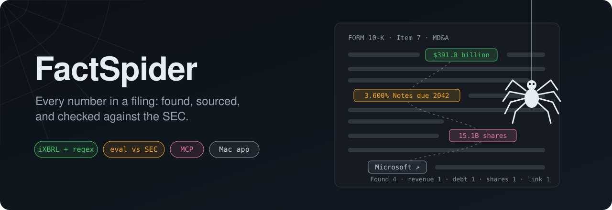
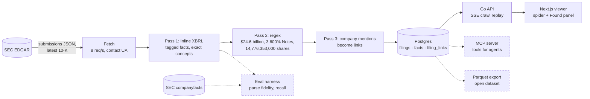
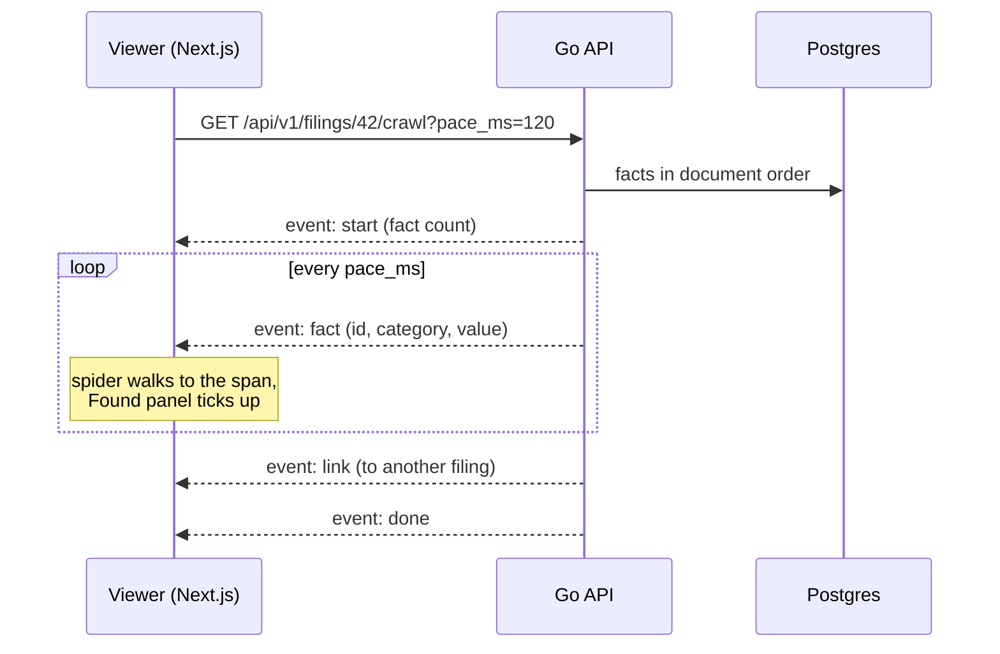
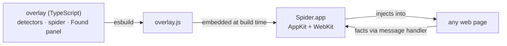
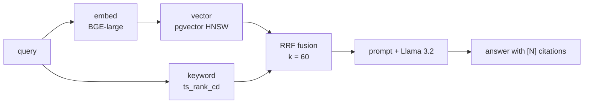

<p align="center">
  
</p>

# FactSpider

A 10-K runs to a hundred pages or more, and the numbers that matter are
scattered through it: revenue in a table on page 40, a bond coupon buried in a
footnote, a share count on the cover.
FactSpider reads the filing for you.
It pulls out every notable figure, remembers exactly where each one came from,
and then lets you *watch* it work: an animated spider walks the document from
fact to fact while a "Found" panel fills up.

The same spider runs on any web page from a native Mac app.
It can also grade itself against the SEC's own data, answer questions for AI
agents over MCP, and export what it finds as Parquet.

> **Name change.**
> This project started as CloudSearch (AWS-docs search and RAG), became the
> EDGAR Spider, and is now FactSpider, because the job has grown past EDGAR:
> find the facts, keep the source, prove the accuracy.
> The repository, the Python package (`ingestion`) and the Go module keep
> their old names for now.

## At a glance

| What | Where it runs | Status |
| ---- | ------------- | ------ |
| 10-K fact extraction (iXBRL + regex + company links) | Python | Shipped |
| Animated crawl viewer at `/filings` | Go SSE + Next.js | Shipped |
| Spider Desktop: the spider on any web page | Native Mac app | Shipped |
| Eval harness: score extraction against SEC companyfacts | Python CLI | MVP built, offline |
| MCP server: filings and facts as tools for Claude | Python, stdio | MVP built |
| Open dataset: facts as Parquet | Python CLI | MVP built, not published |
| System-wide capture: read any app, not just web pages | Mac app | Text engine built; app capture next |
| Local small-model gap filling | Ollama, opt-in | Planned, after the eval |
| AWS-docs hybrid search + RAG (the original stack) | Python + Go | Still works |

"MVP built" means the first slice works and is tested offline.
The live run against real SEC data comes next.
The design for all of it is in
[`docs/superpowers/specs/`](docs/superpowers/specs/).

## How it works



Dashed boxes are new: built and tested offline, not yet run against live SEC
data.

Every fact keeps its position in the document.
The extractor wraps each one in a span the viewer and the spider can find:

```html
<span class="cs-fact" id="f-00042" data-fact-id="f-00042"
      data-category="debt" data-kind="money">3.600% Notes due 2042</span>
```

Facts come in four colors: revenue (green), debt (amber), shares (pink) and
everything else (gray).
Mentions of another company in the universe (Apple, Microsoft, Amazon,
Alphabet, NVIDIA) become links, so the spider can hop from one company's
10-K to another's.

### What a crawl looks like on the wire



The full data and API contract for all three layers is in
[`docs/EDGAR_SPIDER.md`](docs/EDGAR_SPIDER.md).

## Quick start

You need Go 1.23+, Python 3.11+, Node 22 with pnpm, and Postgres 16 with
pgvector.

**1. Postgres.**
With Docker, run `make db-up`.
On a Mac without Docker, Apple's `container` CLI works:

```sh
container system start
container run -d --name cloudsearch-pg -m 1G -p 127.0.0.1:5432:5432 \
  -e POSTGRES_DB=cloudsearch -e POSTGRES_USER=cloudsearch \
  -e POSTGRES_PASSWORD=cloudsearch \
  -e PGDATA=/var/lib/postgresql/data/pgdata \
  -v cloudsearch-pgdata:/var/lib/postgresql/data pgvector/pgvector:pg16
```

**2. Schema and data.**

```sh
make setup && make migrate

# Offline: two synthetic 10-Ks shaped like the real thing.
make edgar-seed

# Or real filings. The SEC asks every client to say who it is.
export SEC_USER_AGENT="Your Name you@example.com"
make edgar-ingest ARGS="--tickers AAPL MSFT AMZN GOOGL NVDA"
```

**3. Watch the spider.**

```sh
make api-dev     # :8080, terminal 2
make web-dev     # :3000, terminal 3
open http://localhost:3000/filings
```

No database at all?
Run the extractor straight on a file:

```sh
make edgar-extract FILE=path/to/aapl-20250927.htm ARGS="--ticker AAPL"
```

## Spider Desktop

The same spider in a native Mac window that works on **any web page**.
Type a URL, press Run, and it walks the rendered page while the Found panel
fills up.
You decide when it runs, how fast it walks (the pace slider works
mid-crawl), and what it collects: money, notes due, percentages, share
counts, dates, big numbers, emails, or your own words and patterns.
"Float on top" keeps it above other apps, and Export saves JSON or CSV.

Nothing leaves the machine.
There is no browser extension and no server.



```sh
make desktop-run     # build the overlay and the app, then launch it
make desktop-app     # desktop/build/Spider.app
make desktop-test    # overlay unit tests + end-to-end self-test on the demo 10-K
```

Contract and design: [`docs/DESKTOP_SPIDER.md`](docs/DESKTOP_SPIDER.md).

## New: eval, MCP, dataset, text capture

Four new pieces, each built separately and reviewed before it was merged in.

**Eval harness.**
Nobody has yet measured how well the extractor does on a real 10-K.
The harness re-extracts a filing and joins its tagged facts to the SEC's own
[companyfacts](https://www.sec.gov/edgar/sec-api-documentation) data by
accession number.
It reports recall, *parse fidelity* (honestly named: the SEC's numbers come
from the same tags we read, so this checks our parsing, not independent
truth), unit accuracy, and how much of the filing could be checked at all.
Its first job is to put numbers on bugs we already suspect, such as earnings
per share stored as plain `USD`.

```sh
# Offline, against a saved companyfacts file:
python -m ingestion edgar eval --file tests/fixtures/edgar/aapl_eps_dims.htm \
  --accession 0000320193-25-000079 \
  --companyfacts tests/fixtures/edgar/companyfacts_aapl_sample.json

# Live, one ticker at a time:
SEC_USER_AGENT="Your Name you@example.com" python -m ingestion edgar eval --tickers AAPL
```

On the test fixture, the output looks like this.
It catches the planted wrong value, flags the EPS unit, and says how much of
the filing it could check:

```text
concept                                exact  rounded  value_mismatch  unverifiable  missed
us-gaap:EarningsPerShareBasic              1        0               0             0       0
us-gaap:NetIncomeLoss                      2        0               1             1       0
...
parse fidelity vs SEC companyfacts: 0.917
unit accuracy: 0.917
verifiable fraction: 0.273 of 44 tags
flags: {'unit_mismatch': 1, 'percent_convention': 1}
truncation: ix tags 63, extracted 55, max_facts 5000 (not truncated)
```

**MCP server.**
Three read-only tools over stdio, `list_filings`, `get_facts` and
`get_provenance`, so Claude or any MCP client can query the facts and jump
to the exact sentence each came from.
Setup, including the `claude mcp add` command, is in
[`docs/EDGAR_SPIDER.md`](docs/EDGAR_SPIDER.md).

```sh
pip install -e ".[mcp]"
python -m ingestion.edgar.mcp_server    # speaks MCP on stdin/stdout
```

**Open dataset.**
`edgar export` writes facts and filings to Parquet with a manifest
(schema version, row counts, file hashes, source attribution).
Nothing gets published until the eval numbers are in.

```sh
pip install -e ".[dataset]"
python -m ingestion edgar export --from-file src/ingestion/edgar/demo/aapl_10k_sample.htm \
  --ticker AAPL --accession 0000320193-25-000079 --out out/dataset
# out/dataset/facts/fiscal_year=2025/facts.parquet, filings.parquet, manifest.json
```

**System-wide capture.**
The overlay's detectors, freed from the browser DOM, now run in
JavaScriptCore inside the Mac app, and `make desktop-test` checks them against
a golden file.
This is the first step toward reading any app (PDFs, spreadsheets,
terminals) with a hotkey.

## The engine underneath

FactSpider sits on the CloudSearch stack, and each layer is in the language
that suits it:

| Layer | Language | Why |
| ----- | -------- | --- |
| Ingestion and extraction | Python | BeautifulSoup, lxml, the ML ecosystem |
| API | Go | One binary, goroutines, SSE streaming |
| Storage | Postgres + pgvector | Facts, vectors and keywords in one database |
| Viewer | Next.js | The spider animation and the search console |
| Desktop | Swift + TypeScript | Native window, shared detectors |

### Spider API

```text
GET /api/v1/filings                      indexed filings with per-category counts
GET /api/v1/filings/{id}                 filing + facts (document order) + links
GET /api/v1/filings/by-ticker/{ticker}   latest filing for a ticker
GET /api/v1/filings/{id}/document        annotated HTML (sanitized, CSP'd)
GET /api/v1/filings/{id}/crawl           SSE replay: ?pace_ms=120&from=0&categories=revenue,debt
```

### Sample data vs real data

`make edgar-seed` loads two **synthetic** filings from
`src/ingestion/edgar/demo/`.
They copy the structure of real Inline XBRL 10-Ks (cover page, securities
table, table of contents, Items, financial tables, the hidden iXBRL header)
so the whole pipeline runs offline, but their figures are illustrative.
`make edgar-ingest` replaces them with real documents.

<details>
<summary><strong>The original CloudSearch: AWS-docs hybrid search and RAG</strong></summary>

Hybrid search over AWS documentation with cited answers, with no API keys
required.
It crawls AWS docs, chunks them by structure, embeds with BGE-large-en-v1.5,
and indexes into Postgres (pgvector + tsvector).
Retrieval runs vector and keyword search concurrently and fuses them with
Reciprocal Rank Fusion.
Answers stream from Llama 3.2 through Ollama, with `[N]` citations back to
the source pages.



**Why hybrid.**
For the query *"verbose logging in aws s3 cp"*, vector search alone returns
server access logging docs, which are similar but wrong.
Keyword search finds the `--debug` flag but ranks it low.
Fusion puts the right page first because it appears in both lists
(`reranker_test.go:TestFuseRRF_CaseStudy_HybridBeatsEitherAlone`).

**Running it.**

```sh
brew install ollama && brew services start ollama && ollama pull llama3.2
make setup && make migrate
make ingest ARGS="--services s3"
EMBED_DEVICE=cpu PYTHONPATH=src .venv/bin/python -m uvicorn \
  api.embed_service.main:app --port 8081    # terminal 2
cd api && go run ./cmd/server                # terminal 3
curl -X POST localhost:8080/api/v1/search -H 'Content-Type: application/json' \
  -d '{"query":"How do I set up an S3 bucket policy?","stream":true}'
```

On Apple Silicon, keep the embed service on the CPU (`EMBED_DEVICE=cpu`).
On the GPU it competes with Ollama, and embeds slow from about 0.3 s to 20 s
or more.

**Switch LLMs with one env var:** `LLM_PROVIDER=ollama|anthropic|openai`,
plus `LLM_MODEL` and, for hosted providers, `LLM_API_KEY`.

**Details that matter in production:** timeouts on every external call,
fallback to keyword-only search when embedding is down, per-IP rate limiting,
a two-level LRU cache, request IDs in every log line, and passwords never
logged.

**Configuration**, all through environment variables:

| Variable | Default | Description |
| -------- | ------- | ----------- |
| `SERVER_PORT` | `8080` | API server port |
| `DB_HOST` / `DB_PORT` | `localhost` / `5432` | Postgres |
| `DB_USER` / `DB_PASSWORD` / `DB_NAME` | `cloudsearch` | Postgres credentials |
| `EMBED_SERVICE_URL` | `http://localhost:8081` | BGE embedding sidecar |
| `LLM_PROVIDER` | `ollama` | `ollama`, `anthropic` or `openai` |
| `LLM_MODEL` | `llama3.2` | Model name |
| `LLM_API_KEY` | | For anthropic and openai only |
| `CACHE_MAX_ENTRIES` / `CACHE_TTL` | `1000` / `15m` | LRU cache |
| `RATE_LIMIT_RPS` | `10` | Requests per second per IP |
| `LOG_LEVEL` | `info` | `debug`, `info`, `warn`, `error` |

</details>

## Project layout

```text
cloudsearch/
├── src/ingestion/
│   ├── edgar/          SEC client, iXBRL + regex extractor, store, CLI, demo 10-Ks
│   └── crawler/ parser/ chunker/ embedder/ indexer/   the AWS-docs pipeline
├── api/                Go API: filings, SSE crawl, hybrid search, RAG
├── web/                Next.js: /filings spider viewer, search console, stats
├── desktop/
│   ├── overlay/        TypeScript detectors, spider and Found panel
│   └── SpiderDesktop/  SwiftPM AppKit + WebKit app
├── alembic/            database migrations
├── docs/               contracts (EDGAR_SPIDER.md, DESKTOP_SPIDER.md) and specs
└── Makefile            every build, run and test target
```

## Tests

```sh
make test          # Python unit and Postgres-backed tests
make api-test      # Go
make desktop-test  # overlay unit tests + the Mac app's self-test on the demo 10-K
make lint          # ruff check + format
```

The Mac app's self-test is the Swift gate: it loads the demo 10-K, runs the
spider, and checks that every expected fact was found.

## Data and fair use

FactSpider reads public filings from SEC EDGAR, which are in the public
domain.
Live requests identify themselves with your `SEC_USER_AGENT` and stay under
eight requests a second, per the SEC's
[fair access policy](https://www.sec.gov/os/accessing-edgar-data).
